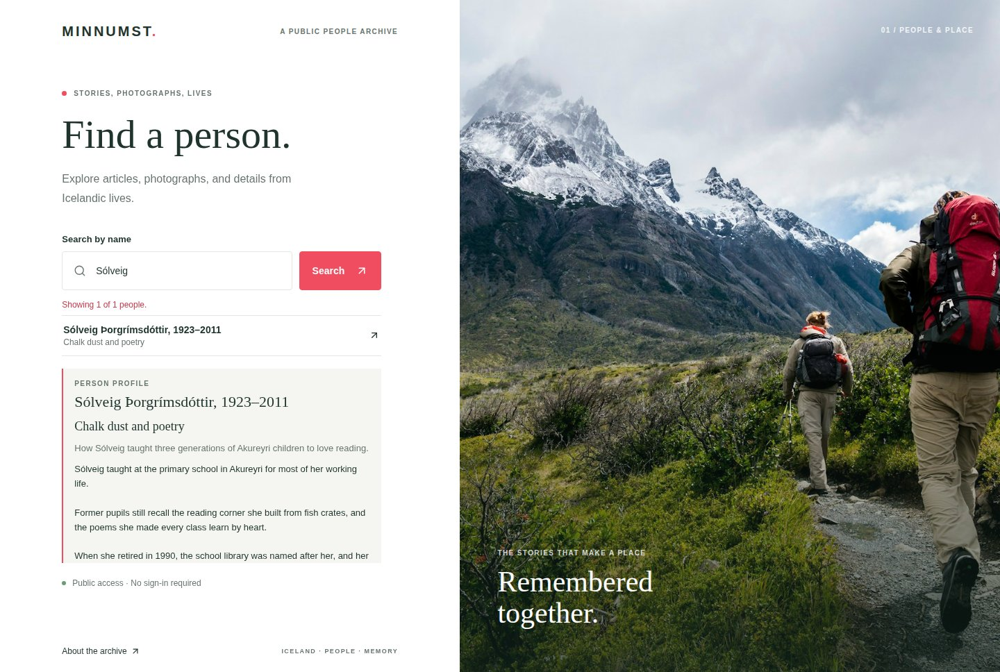
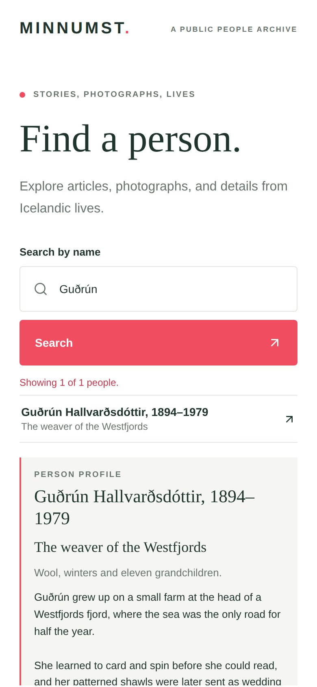
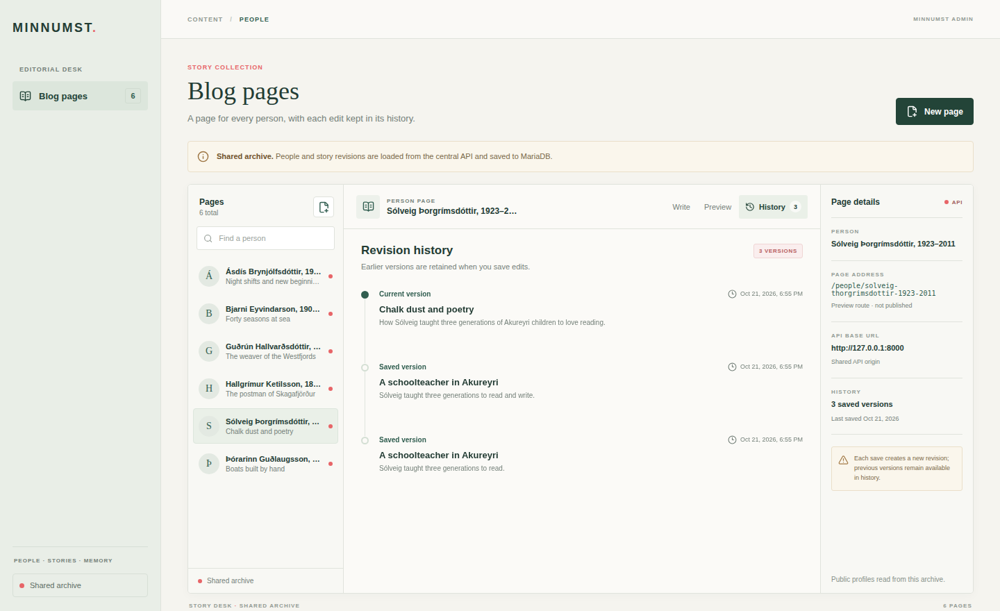

# Minnumst

[](https://github.com/steinnhauser/minnumst/actions/workflows/ci.yml)
[](LICENSE)


> _Minnumst_ (Icelandic: "let us remember") is a shared written history of our ancestors, preserving people and their stories across generations.

Minnumst has a public archive for reading stories, an editorial desk for writing them, and an API that keeps every story revision.
It is self-hosted with Ansible and Docker Compose behind Traefik, with Authentik guarding everything that writes.

<p align="center">
  
  &nbsp;
  
</p>
<p align="center">
  
</p>
<p align="center"><sub>The public archive (desktop and phone) and the editorial desk with a story's revision history. All people and stories shown are fictional sample data.</sub></p>

## Architecture

```text
                 ┌──────────────── Traefik (HTTPS, ACME) ────────────────┐
  readers ──────▶│ web/    public archive (React, read-only)             │
  editors ──────▶│ admin/  editorial desk (React)   ◀── Authentik auth   │
                 │ api/    FastAPI ── PostgreSQL     ◀── auth on writes  │
                 └───────────────────────────────────────────────────────┘
                   deployed by deploy/ (Ansible, Docker Compose, ansible-vault)
```

| Path                                                 | What it is                                                                                        | Stack                                                                   |
| ---------------------------------------------------- | ------------------------------------------------------------------------------------------------- | ----------------------------------------------------------------------- |
| [`api/`](api/)                                       | Data API: people and append-only story revisions                                                  | Python 3.13, FastAPI, SQLAlchemy, PostgreSQL (SQLite locally)           |
| [`web/`](web/)                                       | Public, read-only archive with search                                                             | React, TypeScript, Vite, Vitest                                         |
| [`admin/`](admin/)                                   | Editorial desk for creating people and writing story revisions                                    | React, TypeScript, Vite, Vitest                                         |
| [`packages/static-server/`](packages/static-server/) | Static server, JSON request logs and runtime config shared by both frontend images                | Node.js, Pino                                                           |
| [`packages/api-client/`](packages/api-client/)       | The frontends' API client: types generated from the OpenAPI contract and one shared fetch wrapper | TypeScript (openapi-typescript)                                         |
| [`docker/`](docker/)                                 | Image definitions: one for the API, one for both frontends                                        | Docker                                                                  |
| [`infra/`](infra/)                                   | Creates the Hetzner Cloud server, firewall and data volume, with encrypted state                  | OpenTofu, hcloud                                                        |
| [`deploy/`](deploy/)                                 | Provisioning and deployment to Debian/Ubuntu hosts                                                | Ansible, Docker Compose, Traefik, Authentik forward-auth, ansible-vault |
| [`tools/`](tools/)                                   | Local stack from the deploy Compose template, sample data, end-to-end tests                       | Bash, Docker Compose                                                    |

Each service ships as a non-root container image that logs structured JSON. The frontends read their API URL at runtime, so one image works in every environment.

## Security and networking

Minnumst is built so that the only thing reachable from the internet is a TLS-terminating reverse proxy, every write is authenticated before it reaches the application, and each host process and container can do as little as possible. The controls below are enforced in code and verified in CI on every change.

| Layer               | Standard                                                                                                                  |
| ------------------- | ------------------------------------------------------------------------------------------------------------------------- |
| Host (Ubuntu 24.04) | CIS Ubuntu Linux 24.04 LTS Benchmark (Level 1 – Server, selected Level 2), NIST SP 800-53 Rev. 5; scored with Lynis in CI |
| Infrastructure      | OpenTofu with encrypted state, provider firewall, IaC scanning with Trivy                                                 |
| Containers          | CIS Docker Benchmark, NIST SP 800-190                                                                                     |
| Web and API         | OWASP ASVS (security headers, authentication at the edge, input validation), OWASP Secure Headers                         |
| Supply chain and CI | OpenSSF Scorecard practices (pinned actions, least-privilege tokens, dependency review, SAST), SLSA build provenance      |

Every host setting in [`deploy/`](deploy/) cites the CIS section and NIST control it implements, and the [deployment guide](deploy/README.md#what-the-playbook-enforces) maps them in one table, with the few deliberate deviations explained.

```text
                     internet
                        │ 80 → redirect, 443 TLS (Let's Encrypt)
                ┌───────▼────────┐  security headers · HSTS · rate limit (API)
                │    Traefik     │──── forward-auth ────▶ Authentik (TOTP MFA)
                └──┬─────┬─────┬─┘
     edge network  │     │     │            socket network (internal)
            ┌──────▼┐ ┌──▼────┐ ┌▼─────┐    Traefik ──▶ Docker API proxy
            │  web  │ │ admin │ │ api  │                (list containers only)
            └───────┘ └───────┘ └──┬───┘
                    backend network│(internal, no route out)
                               ┌───▼─────┐
                              │PostgreSQL│
                               └─────────┘
```

**Network**

- **One public entry point.** Only Traefik publishes ports. The apps share the `edge` network with Traefik, and PostgreSQL sits alone with the API on `backend`, an internal network with no route in or out and no host port.
- **TLS everywhere.** HTTP redirects to HTTPS, certificates come from Let's Encrypt, and HSTS (two years, including subdomains) tells browsers never to use plain HTTP again.
- **Authenticated writes.** Authentik forward-auth guards the whole editorial desk and every `POST`, `PUT`, `PATCH` and `DELETE` on the API; reads stay public. Authentik, with TOTP MFA, runs outside this stack, and there is no in-app login to attack.
- **Rate limiting.** The API allows 20 requests per second per client (bursts of 50) and answers floods with `429`.
- **No Docker socket on the edge.** Traefik discovers services through a socket proxy that exposes only the read-only container listing, on its own internal network. The proxy is the only container that mounts the socket.

**Applications**

- **Strict browser policy.** The frontends send a same-origin Content Security Policy that only lets them connect to the API, `frame-ancestors 'none'`, `nosniff`, a strict referrer policy, a restrictive `Permissions-Policy` and cross-origin isolation headers. The CORS allow-list on the API names the two frontends only.
- **Small, immutable surface.** The static server answers only `GET` and `HEAD`. Runtime configuration is served from memory and only exposes explicitly listed public values. Malformed IDs are rejected before any query runs.
- **Accessible.** Text meets WCAG 2.2 AA contrast, and every browser test runs an axe audit that fails on serious problems.
- **A hardened database.** PostgreSQL authenticates every connection with SCRAM-SHA-256. Migrations run as a separate role that owns the schema; the API connects as a runtime role that can't change the schema and can only read and insert story revisions, so history is append-only in the database itself, verified by a test that tries to rewrite it. The schema enforces the rules too: native UUID keys, unique normalised names, positive revision numbers, and foreign keys that refuse to delete a person with a story or a story with revisions.
- **Privacy-preserving logs.** Every service logs JSON with a request ID that follows a request from the browser through the API. Query strings, request bodies, credentials and person slugs are never logged.
- **Append-only data.** Story revisions are immutable; no route edits or deletes them, and a person with a story can't be deleted.

**Host**

- **Provisioned as code.** [`infra/`](infra/) creates the server with OpenTofu: a Hetzner firewall in front of the host's own, deletion protection, and state that is encrypted before it leaves the operator's machine.
- **One supported OS, encrypted.** Ubuntu Server 24.04 LTS; the playbook refuses to deploy unless the data is on LUKS, either the whole disk or a data volume it encrypts itself (the `infra/` setup).
- **Always patched.** Security, Ubuntu and Docker updates install unattended, with an automatic reboot window and service restarts after library updates; Ubuntu Pro Livepatch is optional.
- **Locked-down access.** SSH by key only, never as root, for one allow-listed group, with modern algorithms only; an nftables default-deny firewall with rate-limited SSH; `sudo` with its own log.
- **A hardened kernel and minimal surface.** Kernel and network sysctls, unused filesystems and protocols disabled, no core dumps, AppArmor enforced, snapd and legacy clients removed.
- **A tamper-evident trail.** auditd rules for identity, privilege, SSH, network, kernel module and Docker changes, immutable until reboot; a persistent journal and synchronised time.
- **Encrypted backups.** A nightly `pg_dump`, encrypted with age to a key that never touches the server, and a restore script. CI restores a backup into a fresh database on every change.

**Containers**

- **Least privilege.** Every image runs as a non-root user with its code owned by root, so a compromised process can't change it. At runtime every container, the database included, runs with `no-new-privileges`, a read-only root filesystem and no Linux capabilities.
- **Minimal images.** All three images are built on Alpine, pinned by digest: far fewer packages, and so far fewer vulnerabilities, than a Debian base (moving the API image from Debian took Trivy's count from 254 to none). They drop the package managers they never use (npm, Yarn, Corepack, pip), apply the latest OS security fixes, and carry health checks.
- **Secrets stay out of Git.** Production secrets live only in an encrypted ansible-vault file; the rendered Compose file is written with mode `0600`.

**Supply chain**

- **Pinned and reviewed dependencies.** Python and Node.js dependencies are locked (`uv.lock`, `package-lock.json`) and installed with `--locked`/`npm ci`. Every GitHub Action is pinned to a commit SHA. Dependabot proposes updates weekly after a seven-day cooldown, and pull requests run a dependency review that blocks known high-severity vulnerabilities.
- **Scanned code and images.** CodeQL (security-extended queries) scans the Python, TypeScript and workflow code, Trivy blocks images with fixable high or critical vulnerabilities, and zizmor audits the workflow for injection and permission issues. All of this runs on every change and weekly.
- **Hardened CI.** Jobs start with no token permissions and request only what they need; checkouts don't keep credentials. Only the release job can write packages and releases, and only for a tag on `main` that passed every check.
- **Verifiable releases.** Release images are multi-arch and published with build provenance and an SBOM.

**Verified, not just configured.** The CI `host` job applies the host hardening to a real Ubuntu 24.04 VM, requires a second run to change nothing, and reports the Lynis hardening index before and after (57 → 70 for the stock runner image). `make stack-test` (also the CI `e2e` job) runs the production Compose template with Traefik and a stand-in for Authentik, then [`tools/scripts/e2e_edge.sh`](tools/scripts/e2e_edge.sh) checks the edge from the outside:

- the HTTP redirect, HSTS and CSP;
- that reads are public, while the editorial desk and every write method are refused without authentication;
- that authenticated writes go through;
- the rate limit;
- from the rendered production file, the network isolation and container hardening above.

The same job then restores a backup into a fresh database and runs Playwright browser tests of both frontends, which fail on any CSP violation in the console.

Report vulnerabilities privately as described in [`SECURITY.md`](.github/SECURITY.md).

## Data protection and sources

Minnumst holds the history of people who have died. It never holds data about living people. Every person record, story and source link, whether it comes from an editor or an import, has to meet these rules:

1. **Only people who died more than five years ago.** Iceland's Data Protection Act, [Act No. 90/2018](https://www.althingi.is/lagas/nuna/2018090.html), applies to a deceased person's data for five years after death, and longer for information that would reasonably be kept confidential ([Persónuvernd summary](https://gamli.personuvernd.is/media/glaerukynningar-pv/Kynningarfundur_2018-Fyrirtaeki_og_stofnanir_VEL.pdf)). The GDPR itself doesn't cover deceased persons and leaves them to national law ([Recital 27](https://gdpr-info.eu/recitals/no-27/)). Minnumst stays outside that five-year window entirely. A person qualifies only if:
   - a recorded date of death is more than five years ago, or
   - when no date of death is known, they were born at least 128 years before the current year (the longest verified human lifespan of 122 years, plus the five years, plus one year because census records give only a birth year). In 2026 that means born in 1898 or earlier.

   Anyone who doesn't meet one of these is left out. When in doubt, leave them out.

2. **Nothing confidential, however old.** No health, cause-of-death, criminal, adoption or paternity details beyond what the cited public source itself states.
3. **No living people inside the records.** Obituaries and census households name surviving relatives. Stories and source summaries don't name or describe living people, and no record is created for them.
4. **Link, don't copy.** Newspaper pages, obituaries and archive records are referenced by URL with a short summary written in our own words. Their text and scans aren't copied, because most sources allow personal use only. Every imported record keeps its source and licence.
5. **Removal on request.** A relative can ask for a person, story or link to be corrected or removed, and the request is handled with priority.

### Sources

| Source                                                                                                                                                   | Content                                                                                                               | Terms                                                                              | How Minnumst uses it                                    |
| -------------------------------------------------------------------------------------------------------------------------------------------------------- | --------------------------------------------------------------------------------------------------------------------- | ---------------------------------------------------------------------------------- | ------------------------------------------------------- |
| [ICE-ID](https://huggingface.co/datasets/goldpotatoes/ice-id) ([paper](https://arxiv.org/abs/2506.13792), [code](https://github.com/IIIM-IS/ICE-ID-2.0)) | 984,028 records from 16 Icelandic censuses (1703–1920), linked into 226,864 people with some parent and partner links | CC BY 4.0. Attribution required. The authors exclude re-identifying living people. | Bulk import of people who meet rule 1, with attribution |
| [manntal.is](https://manntal.is/) (National Archives of Iceland)                                                                                         | The same censuses, searchable                                                                                         | Free to search. No download or API.                                                | Links per person                                        |
| [heimildir.is](https://heimildir.is/) (National Archives of Iceland)                                                                                     | Scanned parish registers and parish censuses                                                                          | Free to view                                                                       | Links per person                                        |
| [timarit.is](https://timarit.is/about) (National and University Library of Iceland)                                                                      | 7 million digitised newspaper and magazine pages, including Morgunblaðið since 1913 and its obituaries                | Personal use only. Copyright runs 70 years after the author's death. No API.       | Links to pages with our own summaries                   |
| [gardur.is](https://gardur.is/) (Kirkjugarðasamband Íslands)                                                                                             | The national burial register: dates of birth and death, and the grave                                                 | Free public search                                                                 | Dates of death for rule 1, and links                    |
| [Wikidata](https://www.wikidata.org/)                                                                                                                    | About 8,000 notable Icelanders                                                                                        | CC0                                                                                | Links and enrichment                                    |
| [mbl.is](https://www.mbl.is/)                                                                                                                            | Morgunblaðið obituaries since 1989                                                                                    | Registration or subscription                                                       | Links only                                              |

[Íslendingabók](https://www.islendingabok.is/english) is open only to people with an Icelandic ID number and has no export, so Minnumst doesn't use it. Commercial genealogy sites and the restricted part of the [Icelandic Gigaword Corpus](https://clarin.is/en/resources/gigaword/) aren't used either.

**Status:** today people are added only by editors through the editorial desk, which sits behind authentication, and editors apply these rules. The import and the source links on profiles are planned in [`TODO.md`](TODO.md) item 12. The rule 1 check will be enforced by the import and the API rather than left to editors. All sample data in this repository is fictional.

## Development

This is a monorepo with one toolchain per language: a [uv](https://docs.astral.sh/uv/) workspace for Python (`pyproject.toml`, `uv.lock`, Python version in `.python-version`) and an npm workspace for Node.js (`package.json`, `package-lock.json`, Node.js version in `.nvmrc`). The root [`Makefile`](Makefile) is the entry point; `make help` lists every target.

```sh
make install       # locked Python and Node.js dependencies
make format        # Ruff and Prettier; format-check, lint, test and build work across the repository too
make validate      # everything CI checks except the stack (needs Docker for the PostgreSQL tests)
```

Run the whole stack in containers, rendered from the same Compose template that `deploy/` uses (Traefik, PostgreSQL, the API and both frontends):

```sh
make stack-test    # build the images, start the stack, seed sample data, run the API and edge tests
make down          # stop it; the database volume is kept
```

The archive is then on <http://127.0.0.1:5173>, the editorial desk on <http://127.0.0.1:5174> and the API docs on <http://127.0.0.1:8000/docs>.

For quicker iteration, run the development servers instead, each in its own terminal: `make dev-api`, `make dev-web` and `make dev-admin`. They work without configuration. [CONTRIBUTING](CONTRIBUTING.md) has the details, and [`deploy/README.md`](deploy/README.md) covers production.

## Test coverage

`make test` runs pytest (SQLite) for the API and Vitest for the frontends and shared packages, and fails on any uncovered line or branch (and function, for TypeScript); the gates are in [`pyproject.toml`](pyproject.toml) and [`vitest.config.ts`](vitest.config.ts). The table comes from the last run: `make coverage-readme` updates it, and CI fails if it is out of date. The PostgreSQL-only tests, the stack's end-to-end tests and the browser tests run on top of this.

<!-- prettier-ignore-start -->
<!-- coverage:start -->

| Component | Lines | Statements | Branches | Functions |
| --- | --- | --- | --- | --- |
| `api/` | 100.0% | 100.0% | 100.0% | — |
| `web/` | 100.0% | 100.0% | 100.0% | 100.0% |
| `admin/` | 100.0% | 100.0% | 100.0% | 100.0% |
| `packages/` | 100.0% | 100.0% | 100.0% | 100.0% |

<!-- coverage:end -->
<!-- prettier-ignore-end -->

## CI and releases

One workflow, [`ci.yml`](.github/workflows/ci.yml), runs on every push, pull request and release tag, using the same `make` targets:

| Job        | Checks                                                                                                                              |
| ---------- | ----------------------------------------------------------------------------------------------------------------------------------- |
| `changes`  | Detects documentation-only changes, which skip the slower jobs below (tags, schedules and manual runs always run everything)        |
| `checks`   | Ruff, Prettier, ESLint, ShellCheck, ansible-lint, playbook syntax, OpenAPI freshness, API wheel and frontend builds                 |
| `tests`    | pytest on SQLite and on PostgreSQL (Testcontainers), Vitest, the 100% coverage gates and the README's coverage table                |
| `e2e`      | Builds the images, runs the stack, then the API, edge, backup-restore and browser tests (CSP, axe), and scans the images with Trivy |
| `host`     | Applies the host hardening to an Ubuntu 24.04 VM twice (the second run must change nothing) and scores it with Lynis                |
| `codeql`   | CodeQL security-extended analysis of the Python, TypeScript and workflow code                                                       |
| `pr-title` | Pull requests only: the title must be a Conventional Commit, because it becomes the squash commit `make release` reads              |
| `ci-ok`    | Passes only when every other job passed; the single check to require on pull requests                                               |
| `release`  | On a release tag only: publishes the component's multi-arch image to GHCR and its GitHub Release                                    |

Dependabot keeps npm, uv, Docker base images and GitHub Actions up to date, in weekly grouped pull requests.

Each component is versioned on its own, with tags such as `api-0.2.0`. `make release COMPONENT=api` reads the Conventional Commits that touched the component since its last tag, bumps the version, adds a `CHANGELOG.md` section, commits and tags; it never pushes. Pushing the tag runs the checks again and then publishes `ghcr.io/steinnhauser/minnumst-api:0.2.0` (and `:0.2`) for `linux/amd64` and `linux/arm64`, with provenance and an SBOM, plus a GitHub Release with that changelog section. `deploy` releases have no image.

## History

The project was previously called **Eftirmál**. This repository combines four earlier repositories, `eftirmal-api`, `eftirmal`, `eftirmal-admin` and `eftirmal-deploy`, with their commits kept.
They now share one toolchain, one workflow and one license.

## License

[Apache License 2.0](LICENSE)
