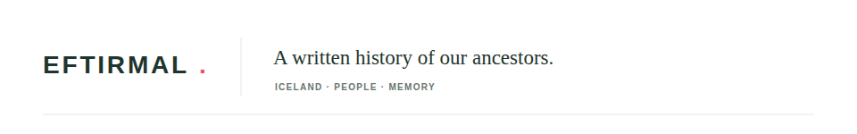

# Eftirmál | Public Archive



> Eftirmál is a shared written history of our ancestors, preserving people and their stories across generations.

This is the public-facing React, TypeScript, and Vite frontend for searching the archive and reading published stories. It is read-only and has no sign-in flow.

## Requirements

- Node.js 20.19 or newer
- npm

## Getting Started

```sh
make install
cp .env.example .env
make dev-start
```

Start the API separately with `make -C ../eftirmal-api dev-start`. The public frontend runs at `http://127.0.0.1:5173/`; use `make dev-stop` to stop it. `VITE_API_URL` is the API origin, not an `/api` path. It defaults to `http://127.0.0.1:8000`.

## Commands

| Command             | Purpose                                               |
| ------------------- | ----------------------------------------------------- |
| `make format`       | Format source, configuration, and documentation files |
| `make format-check` | Check formatting without writing changes              |
| `make lint`         | Run ESLint                                            |
| `make test`         | Run the Vitest suite once                             |
| `make test-watch`   | Run tests in watch mode                               |
| `make validate`     | Run formatting, lint, tests, and production build     |
| `make build`        | Type-check and build the production frontend          |
| `make dev-start`    | Start Vite in the background                          |
| `make dev-stop`     | Stop the process started by `make dev-start`          |
| `make preview`      | Preview the production build locally                  |
| `make clean`        | Remove build and coverage output                      |

The matching npm scripts are available directly in `package.json`.

## Current Scope

The public search uses `GET /api/people?query=...&offset=0&limit=50`. Selecting a result loads `GET /api/people/by-slug/{slug}` and displays its current blog revision when one exists. Search and profile details are public; administration is handled by the separate admin service.

The landing photograph is bundled locally from [Unsplash](https://images.unsplash.com/photo-1551632811-561732d1e306), so the page does not depend on an image host at runtime.

## Container Image

The Dockerfile builds the Vite bundle and serves it as a non-root user on port `8080`. The image reads `VITE_API_URL` from its runtime environment at startup; no API URL is required during the build:

```sh
docker build -t eftirmal:local .
docker run --rm -p 8080:8080 -e VITE_API_URL=https://api.example.com eftirmal:local
```

Tagged releases publish a multi-platform private image to `ghcr.io/steinnhauser/eftirmal` as both `<version>` and `latest`. The image is environment-neutral; deployment Compose supplies `VITE_API_URL` from the configured API hostname.

```

```
